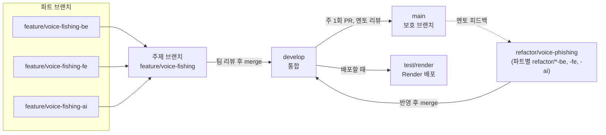

# 브랜치 전략

우리 팀은 FE, BE, AI 세 파트가 한 주에 하나의 주제(예: 통화 녹음 확인)를 함께 만듭니다.
그래서 브랜치를 **파트 브랜치 → 주제 브랜치 → `develop` → `main`** 네 단계로 쌓았습니다.
파트끼리는 주제 브랜치에서 먼저 맞춰 보고, 맞춘 결과만 `develop` 에 들어가게 하려는 구조입니다.

규칙의 원문은 저장소의 `docs/conventions.md` 이고, 이 페이지는 그 규칙과 실제로 운영한 방식을 함께 정리했습니다.

## 1. 한눈에 보기

## 2. 브랜치 종류

| 브랜치 | 용도 | 규칙 |
| --- | --- | --- |
| `main` | 멘토 리뷰를 통과한 결과 | Rulesets로 보호합니다. 직접 push를 막고 PR merge만 허용합니다. 멘토 승인 뒤 팀장이 merge합니다 |
| `develop` | 기본 개발, 통합 브랜치 | 보호하지 않고 팀이 관리합니다. 핫픽스와 간단한 리팩토링은 직접 push를 허용합니다 |
| `feature/<주제>` | 한 주의 기능 주제를 모으는 주제 브랜치 | `develop` 에서 만들고, 파트 브랜치를 받은 뒤 팀 리뷰를 거쳐 `develop` 으로 merge합니다 |
| `feature/<주제>-be`, `-fe`, `-ai` | 파트별 작업 브랜치 | 주제 브랜치에서 만들고 주제 브랜치로 PR을 올립니다 |
| `refactor/<주제>` (+ `-be`, `-fe`, `-ai`) | 멘토 피드백 반영 | `develop` 에서 만들고 구조는 `feature/*` 와 같습니다 |
| `fix/<내용>` | 버그, 보안 수정 | 규칙은 `feature/*` 와 같습니다 |
| `test/render` | Render 배포용 | 배포 전에 `develop` 이나 검증할 브랜치를 PR로 받습니다. 테크스펙의 기준 커밋 `45871b8` 이 이 브랜치에 있습니다 |

## 3. 한 주의 흐름

1. **주제 정하기.** 그 주에 만들 기능을 하나의 주제로 정하고 `feature/<주제>` 를 만듭니다.
2. **파트별 작업.** FE, BE, AI가 각자 `feature/<주제>-fe`, `-be`, `-ai` 에서 작업하고 주제 브랜치로 PR을 올립니다. 같은 파트를 맡은 팀원이 리뷰합니다.
3. **주제 통합.** 주제 브랜치에서 파트 결과가 맞물리는지 확인한 뒤 `develop` 으로 merge합니다.
4. **멘토 리뷰 요청.** 팀장이 `develop` → `main` PR을 올리고, 검토받고 싶은 설계 포인트를 적습니다.
5. **피드백 반영.** 팀에서 반영 방향을 정하고 `refactor/<주제>` 와 파트별 `refactor/*` 에서 고친 뒤 `develop` 으로 merge합니다.
6. **재리뷰와 merge.** 멘토 리뷰 댓글에 반영 PR 링크를 답글로 남기고 재리뷰를 요청합니다. 승인되면 팀장이 `main` 으로 merge합니다.

### 실제 주제 브랜치

| 멘토 리뷰 PR | 올린 날 | 주제 브랜치 |
| --- | --- | --- |
| #7 | 09-16 | `feature/smishing-message-intake` |
| #24 | 09-23 | `feature/scenario-message-test` |
| #39 | 09-30 | `feature/scenario-message-test-2` |
| #54 | 10-07 | `feature/isolation-env`, `feature/edit-card`, `feature/rag-fix` |
| #86 | 10-14 | `feature/edit-card-final`, `feature/rag-fix-final`, `refactor/scenario-message-test-3` |
| #114 | 10-28 | `feature/voice-fishing`, `feature/link-recognize`, `refactor/voice-phishing` |
| #147 | 11-04 | `feature/final`, `refactor/final` |

각 주제의 피드백 반영은 다음 주 `refactor/<주제>` 에서 했습니다(예: #7 이후 `refactor/smishing-message-intake`, #114 이후 `refactor/voice-phishing`).

멘토 리뷰의 내용과 반영 결과는 [코드 리뷰 기록](#code-review)에 정리했습니다.

## 4. 실제 운영 기록

기준 커밋 `45871b8` (2026-11-10)까지의 기록입니다.

| 항목 | 값 |
| --- | --- |
| merge된 PR | 112개 |
| 그중 작업 브랜치 → 주제 브랜치 | 67개 |
| 그중 → `develop` | 33개 |
| `develop` → `main` 멘토 리뷰 PR | 7개 (모두 변경 요청 뒤 승인) |
| → `test/render` 배포 PR | 4개 |

파트끼리 맞춰 보는 일이 주제 브랜치에서 먼저 일어났기 때문에, PR의 절반 넘게가 `develop` 이 아니라 주제 브랜치로 들어갔습니다.

## 5. 커밋 메시지

`<종류>(<범위>): <무엇을 왜>` 꼴로 씁니다. 범위는 생략할 수 있습니다.

| 종류 | 쓰는 때 |
| --- | --- |
| `feat` | 기능 추가 |
| `fix` | 버그, 보안 수정 |
| `refactor` | 동작을 바꾸지 않는 구조 변경 |
| `docs` | 문서만 바꿈 |
| `test` | 테스트만 바꿈 |
| `chore` | 설정, 빌드 등 그 밖의 작업 |

범위에는 주로 파트(`fe`, `be`, `ai`)나 모듈(`kb`, `isolation`, `eval`, `scanner`)을 씁니다.

예시:

- `fix(isolation): build.sh 가 수집기를 먼저 멈춰 systemd 재시작 전파에 기대지 않는다`
- `test(isolation): systemd 가 재시작을 전파하지 않으면 새 컨테이너가 안 뜨는 것을 재현한다`

기준 커밋까지 merge 커밋을 뺀 커밋 622개 중 576개(92.6%)가 이 꼴을 지켰습니다.
