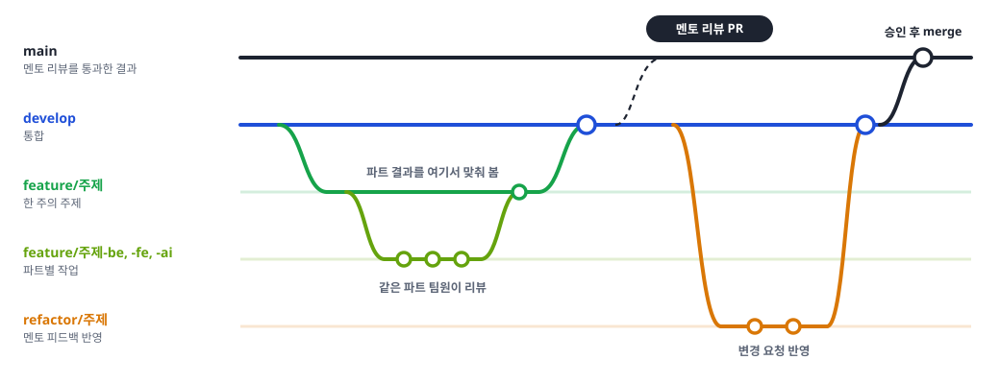

# 브랜치 전략

FE, BE, AI 세 파트가 한 주에 하나의 주제를 함께 만들었습니다. 그래서 브랜치를 **파트 브랜치 → 주제 브랜치 → `develop` → `main`** 네 단계로 쌓았습니다.
파트끼리는 주제 브랜치에서 먼저 맞춰 보고, 맞춘 결과만 `develop` 에 들어가게 하려는 구조입니다.

<figure class="figure"></figure>

## 브랜치

| 브랜치 | 용도 |
| --- | --- |
| `main` | 멘토 승인을 받은 결과. 보호 브랜치라 PR merge만 됩니다 |
| `develop` | 통합 브랜치. 핫픽스와 간단한 리팩토링은 직접 push를 허용합니다 |
| `feature/<주제>` | 한 주의 주제. 파트 브랜치를 모아 맞춰 봅니다 |
| `feature/<주제>-be`, `-fe`, `-ai` | 파트별 작업. 같은 파트 팀원이 리뷰합니다 |
| `refactor/<주제>` | 멘토 피드백 반영. 구조는 `feature` 와 같습니다 |
| `fix/<내용>` | 버그, 보안 수정 |
| `test/render` | Render 테스트 배포용. 계속 쓸 배포 브랜치가 아니라 시연 전 테스트를 위해 둔 브랜치입니다 |

> **남은 일**: 지금은 Render가 `test/render` 를 배포합니다. 앞으로 배포 브랜치를 `main` 으로 바꿔, 멘토 승인을 받은 결과만 배포되게 해야 합니다.

## 커밋 메시지

`<종류>(<범위>): <무엇을 왜>` 꼴로 씁니다. 종류는 `feat`, `fix`, `refactor`, `docs`, `test`, `chore` 이고, 범위에는 파트(`fe`, `be`, `ai`)나 모듈(`kb`, `isolation`)을 씁니다.

```text
test(isolation): systemd 가 재시작을 전파하지 않으면 새 컨테이너가 안 뜨는 것을 재현한다
fix(isolation): build.sh 가 수집기를 먼저 멈춰 systemd 재시작 전파에 기대지 않는다
```

<details>
<summary>주차별 주제 브랜치 보기</summary>

| 멘토 리뷰 PR | 올린 날 | 주제 브랜치 |
| --- | --- | --- |
| #7 | 09-16 | `feature/smishing-message-intake` |
| #24 | 09-23 | `feature/scenario-message-test` |
| #39 | 09-30 | `feature/scenario-message-test-2` |
| #54 | 10-07 | `feature/isolation-env`, `feature/edit-card`, `feature/rag-fix` |
| #86 | 10-14 | `feature/edit-card-final`, `feature/rag-fix-final` |
| #114 | 10-28 | `feature/voice-fishing`, `feature/link-recognize` |
| #147 | 11-04 | `feature/final`, `refactor/final` |

</details>
