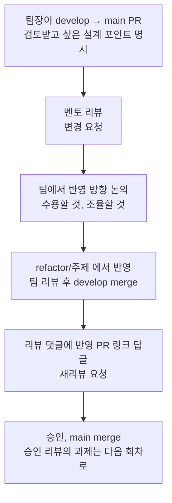

# 코드 리뷰 기록

매주 `develop` → `main` PR로 멘토 리뷰를 받았습니다. 일곱 번 모두 **변경 요청을 받고, 반영한 뒤 승인**받았습니다.
이 페이지는 회차마다 멘토가 짚은 것, 팀이 반영한 PR과 커밋, 반영하지 못한 것을 정리했습니다.
모든 항목은 PR 리뷰 원문, PR 본문과 댓글, 커밋 기록으로 확인한 것만 적었습니다.

## 1. 리뷰를 받고 반영한 방법

PR 본문에는 세 가지를 꼭 적었습니다. 무엇을 왜 바꿨는지, 검토받고 싶은 곳, 검토한 대안과 알려진 한계입니다.
재리뷰를 요청할 때는 "지난 리뷰 반영" 절에 피드백과 반영 위치를 짝지어 적고, 반영하지 않기로 한 것은 이유를 함께 적었습니다.

## 2. 한눈에 보기

| 회차 | 리뷰, 승인 | 핵심 피드백 | 반영 결과 |
| --- | --- | --- | --- |
| #7 | 09-16, 09-19 | 위험 지점을 나누고, 판단 보류를 사례로 검증하고, 동시 요청을 재 볼 것 | 메인 서버는 의심 URL에 접속하지 않음(ADR 0002), 콜백 전환(ADR 0003), 결정적 판정 (#14) |
| #24 | 09-25, 09-26 | `official` 의 의미를 합의하고, 분석 실패와 의심을 구분할 것 | 분석값 보존, 문자 분석과 URL 검사 병렬화, 작업 저장소, HTML 처리 상한 (#30) |
| #39 | 09-30, 10-03 | 결론과 행동을 먼저 주고, 공식 주소 일치만으로 정상이라 하지 말 것 | 결과 카드 선택 규칙과 「결과 확인」 (#45), 판단 보류 카드의 확인 범위 (#48) |
| #54 | 10-07, 10-10 | 수집기는 기본으로 끄고, 허용 주소 밖은 코드와 네트워크 두 단계로 막을 것 | 압축 폭탄, TLS 재시도 결함 수정, 격리 수집 API (#63), 공식 주소 오안내와 콜백 SSRF 수정 (#92) |
| #86 | 10-15, 10-19 | 세 시나리오를 함께 진행하고, LLM은 읽기만 맡길 것 | 설계 v3와 통화 녹음 확인 (#103, #112) |
| #114 | 10-28, 10-31 | 화자 분리의 효과를 확인하고, 지원 범위를 정할 것 | 화자 분리 제거(ADR 0008), 공식 판정 기준 정리(ADR 0009) |
| #147 | 11-05, 11-07 | 정규식은 좁혀서 고치고, 시연 흐름을 경계 입력까지 확인할 것 | 부탁 꼴과 기관 자기소개 수정과 테스트, Render에서 경계 입력 확인 (#154) |

## 3. 회차별 기록

### 1회차. #7 초기 구조와 분석 설계

**멘토가 짚은 것**

- AI만 따로 떼는 것으로는 부족하다. "AI가 텍스트를 해석하는 위험"과 "서버가 의심 URL에 직접 접속하는 위험"은 다르고, HEAD 요청만 써도 접근 위험은 남는다.
- 판단 보류와 분석 불가를 실제 사례에 대입해 보고, 사용자의 다음 행동이 달라지는지 확인할 것.
- 요청이 겹칠 때 첫 응답 시간과 메모리를 재 보고, 결과 전달 방식을 정할 것.
- 출처가 있는 테스트셋, 카카오톡에서 직접 확인하는 E2E, FE 화면 3안 비교, 리뷰어용 채널 링크.

**반영** (#14, 파트별 #10 BE, #11 FE, #12 AI)

- 격리 환경을 별도 서버로 두고, 메인 서버는 의심 URL에 접속하지 않기로 했습니다(ADR 0002). 보안 체크리스트의 HEAD 항목도 이에 맞췄습니다(#15).
- LLM과 네트워크를 쓰지 않는 결정적 판정을 넣었습니다.
- 동시 요청 부하 실험과 실채널 측정(같은 단축 URL이 33초에서 1분 넘게 걸림)을 거쳐 카카오 콜백 방식으로 바꾸고, 결과를 저장해 다시 조회하는 경로를 두었습니다(ADR 0003).
- 지식베이스 299건과 평가셋 127건을 나누고 겹치지 않는지 테스트로 검사합니다. 카카오 채널에서 6가지 경우를 확인했고, 결과 화면 3안을 비교했습니다.

**하지 못한 것**: 기대 결과를 사람이 하나씩 검토하는 일과 사용자에게 스케치를 보여 주는 실험은 하지 못했다고 #14 본문에 적었습니다.

**승인**: 피드백을 코드와 실험으로 연결했고, URL 접근 경계를 다시 검토했으며, 한계를 솔직하게 밝혔다는 평가를 받았습니다.

### 2회차. #24 문자, 페이지 분석과 카카오 챗봇 연동

**멘토가 짚은 것**

- `official` 의 형태보다 의미를 먼저 합의할 것. urlscan 점수로 만든 값과 공식 링크 일치 여부는 다른 판단이다.
- 점수가 0 이하이면 `official=true` 가 되면서 문자에서 찾은 근거가 사라졌다. 수집 실패, 미연결, 일부 수집도 같은 값으로 나왔다.
  > "분석에 실패했다는 이유만으로 악성 근거를 발견한 것처럼 안내해서도 안 됩니다."
- 문자 LLM 두 단계 상한을 합치면 60초인데 BE 상한은 45초였고, 문자 분석이 끝나야 URL 검사가 시작됐다.
- HTML 수신과 파싱에도 상한을 둘 것.

**반영** (#30, 파트별 #25 BE, #26 FE, #28 AI)

- BE: 작업 저장소와 조회 API를 추가하고, 문자 분석과 URL 검사를 병렬로 바꿨습니다.
- AI: 공식 여부와 상관없이 분석값을 보존하고, 실패는 `null`, 의심은 `false` 로 나눴습니다. HTML 깊이, 처리 시간, 출력, LLM 입력에 상한을 걸었습니다.
- 다음 주에 `official` 을 `official`, `brand_mismatch`, `not_registered`, `unresolved` 네 값으로 나누고, 원본 점수는 따로 남기기로 BE, AI가 합의했습니다(#31, #32).

**조율한 것**: 결과 값을 바꾸는 일은 파트 간 계약을 함께 바꿔야 해서 이번 회차에서는 보류하고, 위의 합의로 다음 주에 반영했습니다.

**승인**: 사례별 기대 결과를 구현과 비교했고, 작업과 콜백 상태 관리, AI 근거 보존을 개선했다는 평가를 받았습니다.

### 3회차. #39 결과 스키마 합의와 공식 도메인 대조

**멘토가 짚은 것**

- 사용자에게는 결론과 다음 행동을 먼저 줄 것. `partial` 같은 상태는 내부에서만 쓴다.
  > "사용자에게는 결론을 전달해주세요"
- 외부 스캔이 실패해도 이미 확보한 문자 위험 근거는 안내할 것.
- 공식 도메인 일치만으로 정상이라고 하거나, 목록에 없다는 이유만으로 위험이라고 하지 말 것.
- 승인 과제: 결과 조회 안내를 카드와 메뉴에 넣을 것, 링크 없는 문자에 재입력만 요구하지 말 것, RAG 평가는 전처리를 운영과 맞춘 뒤 비교할 것.

**반영** (#45, 승인 과제는 #48)

- R1, R8, R9 카드가 결론과 행동을 먼저 말하게 했고, 카드 선택 규칙을 고쳤습니다(아래 5절 팀원 간 리뷰의 #40).
- 사용자 ID로 결과를 다시 조회하는 「결과 확인」을 넣고, 붙여넣기 안내 카드와 하단 메뉴에 안내했습니다.
- 판단 보류 카드(R9)를 "확인한 것 / 확인하지 못한 것"으로 나눴습니다.
- 스캔 실패 때 문자 근거를 유지하는 것은 #102에서, 링크 없는 문자의 요구 분석은 #132에서 이어서 반영했습니다.

**승인**: 공식 도메인과 스캐너 점수를 구분하고, 공식 도메인에서도 문자 근거를 남긴 변경을 확인받았습니다.

### 4회차. #54 결과 안내 개선과 EC2 격리 환경

**멘토가 짚은 것**

- 수집기가 메인 서버에서 돌고 있으니 기본값을 꺼짐으로 둘 것.
- 직접 재현해 보여 준 결함 4가지: gzip 해제 중 메모리가 약 81MB까지 오름, 인증서와 무관한 TLS 오류에도 검증을 끄고 재접속, 기관을 몰라 대조하지 못했는데 "목록에 없는 주소"로 안내, 시간 초과로 끝난 분석을 "위험 신호 없음"으로 안내.
- 허용 주소 밖은 코드와 네트워크 두 단계에서 막을 것.
  > "주소를 검사하는 코드만으로 끝내지 말고 네트워크에서도 막아야 합니다."
- 승인 과제: 대표 시나리오를 세 가지로 넓히고, 공식 주소 오안내와 콜백 SSRF를 먼저 고칠 것.

**반영** (#63, 승인 과제는 #92)

- 수집기를 기본으로 끄고 분석과 분리했습니다(`0244ad3`).
- 압축 응답은 본문을 읽지 않고 건너뛰고, 검증을 끄는 재접속은 인증서 오류일 때로 좁혔습니다(`ab69fed`).
- 격리 수집 API에서 허용 목록을 코드(수집기, 프록시)와 네트워크(호스트 방화벽, 보안 그룹) 두 단계에서 막고, 브라우저 샌드박스가 켜져 있는지 배포 검증으로 확인합니다. 인증은 Bearer 토큰과 인증서로 합니다.
- 공식 판정을 문자 속 링크 도메인 기준으로 바꾸고, 콜백 주소 허용 목록(`callback_guard.py`)을 넣었습니다(`358e8b7`).

**조율한 것**: 인증서 고정 대신 MVP 동안 Let's Encrypt와 토큰을 쓰기로 했고, 멘토가 승인 때 이 방식에 동의했습니다. 2코어 4GB 환경 측정은 테스트 페이지가 준비되지 않아 하지 못했습니다.

### 5회차. #86 판단 보류와 자세히 보기 안내

**멘토가 짚은 것**

- 보이스피싱과 링크 없는 사칭을 미루지 말고 작은 범위로 함께 진행할 것.
- 공식 주소에서 다른 곳으로 이동하거나 단축 주소인 경우는 "어디까지 확인했는지"에 맞춰 판단 보류로 안내할 것.
- '주의 필요' 상태를 새로 만들기보다 첫 문장과 행동 안내를 다듬을 것.
- 승인 과제: LLM은 주장과 요구를 읽는 데만 쓰고, 선택지에 따른 분기는 코드로 할 것.
  > "LLM을 다시 호출할 이유는 없어 보입니다."

**반영**

- 판단 보류 사유를 단축 주소와 공식 주소 이동 두 가지로 나누고 카드 문구를 맞췄습니다(이슈 #66).
- 상태를 추가하지 않고 R9 첫머리를 의심 정황에 따라 두 갈래로 나눴습니다.
- 설계 v3에서 자율 판단 루프를 접고, LLM은 읽기만 하고 결론과 다음 안내는 코드가 정하게 했습니다(#103). 통화 녹음 확인을 파트별로 만들어 #112로 통합했습니다.
- 결과 웹을 만들지 않고 카드로만 보여 주기로 정했습니다(ADR 0005 유지, ADR 0006 기각).

### 6회차. #114 통화 녹음 확인과 분석 설계 v3

**멘토가 짚은 것**

- 새 주의 조건은 주의 안내까지만 쓰고, 실제 경찰 연락 같은 정상 사례와 비교할 것.
- 화자 분리를 하지 않은 경우와 정확도, 처리 시간을 비교하고, 효과가 작으면 대화 전체를 분석하는 방식으로 완성할 것.
  > "화자 분리를 하지 않은 것을 '분리 실패'로 처리하지 않도록"
- 긴 녹음은 지원할 길이를 먼저 정할 것. 사례 검색 수치는 현재 구성에서 잰 값만 쓸 것.
- 인라인 지적 6건: 의무 표현이 버려짐, 부정 검사 범위가 넓음, 다운로드 취소 시 임시 파일이 남음, 폴백에서 자기소개가 빠짐, 복문 부정 오판, 링크 3개 이상이면 미검사 안내가 빠짐.

**반영** (#128, #129)

- 화자 분리를 없애고 받는 사람 쪽 말은 문장 꼴로 거르게 했습니다(ADR 0008, `8260d8c`). 정상 통화 4,500건에서 의심 결론이 2.3%에서 0.1%로 줄었고, 어휘표만 쓴 대리 평가라는 단서를 함께 적었습니다.
- 의무 표현은 요구로 남기고, 부정은 절 끝 서술어 기준으로 봅니다. 다운로드 취소는 회귀 테스트로 지켰습니다.
- 승인 후속으로 공식 판정 기준을 정리했고(ADR 0009), 미검사 링크 안내를 유지하고, 폴백 자기소개를 고쳤습니다.

**조율한 것**: 콜드 스타트 단축은 하지 않고 시연 전에 서버를 미리 깨워 두기로 했습니다.

### 7회차. #147 링크 없는 사칭 문자와 시연 전 안정화

**멘토가 짚은 것**

- 다중 링크는 임시 대응을 유지하고 요약 캐러셀은 시연 뒤로 미루되, 미검사 안내는 빠지지 않게 할 것.
- 문장 꼴 정규식은 구조를 유지하고, 실제 요청까지 빠지는 경우만 좁혀서 고칠 것. 인라인으로 "50만원만 보내줄래요?"와 "저는 국세청 직원입니다"가 걸러지는 경우를 짚었습니다.
  > "오탐이 줄었다는 수치만으로 개선됐다고 보기는 어렵겠습니다."
- Render 설정에서 정상 페이지와 256KiB 경계 입력을 확인할 것.

**반영** (#154)

- 부탁 꼴은 남기고 되묻기는 계속 거르게 했습니다. 공공기관 자기소개는 남기되 주의까지만 쓰기로 했습니다(ADR 0010). 넓히면서 생긴 회귀를 다시 좁히고 대비 테스트를 붙였습니다(`2f3d6c0`, `aa81f9a`, `6c5b2d5`).
- 미검사 안내가 남는지 테스트로 확인했습니다(`tests/test_read_message_flow.py`).
- Render에서 정상 택배 페이지가 끝까지 분석되고(8.5초), 1MB가 넘는 페이지는 "끝까지 확인하지 못했어요" 안내로 이어지며, 그 뒤 요청도 정상 처리되는 것을 확인했습니다.

**승인**: 부탁 표현과 기관 자기소개 누락을 보완하고 테스트를 추가한 점, Render에서 입력 제한과 이후 요청 처리를 확인한 점을 인정받았습니다.

## 4. 아직 반영하지 못한 것

리뷰에서 받았지만 기준 커밋 `45871b8` 까지 코드에 들어가지 않은 것입니다.

| 피드백 | 회차 | 지금 상태 |
| --- | --- | --- |
| 콜백 허용 목록은 실제 쓰는 호스트만, 설정이 없으면 보내지 않기 | #86 | 코드 기본값은 아직 `kakao.com` 하위 허용입니다. 운영 서버에는 실제 호스트 하나만 설정했습니다 |
| 자세히 보기에 페이지 근거도 보여 주기 | #86 | 페이지 신호용 고정 문구가 없어 문자 신호만 카드로 만듭니다 |
| 복문 부정 표현 처리 | #114 | #147 본문에 "아직 반영하지 못한 것"으로 남겼습니다 |
| 녹음 길이 상한 | #114 | 정하지 못했습니다. 25MB 크기 상한만 있습니다 |

## 5. 팀원 간 리뷰

팀 내부 리뷰는 GitHub의 승인 버튼보다 **PR 댓글과 이슈 스레드**에서 주로 오갔습니다. 대표 사례입니다.

**#40 결과 카드 선택 규칙 (FE → BE)**

- FE가 실환경 테스트 로그를 보다가, 카드 선택 코드가 FE 문서와 다르다는 것을 찾았습니다. `brand_mismatch` 인데 위험 카드(R1)가 나가고, 브랜드를 못 찾으면 `"unknown"` 문자열이 검사를 통과해 "택배사(unknown)" 문구가 나가고 있었습니다.
- 3회차 멘토 리뷰("목록에 없다는 이유만으로 위험이라고 하지 않는다")를 근거로 고칠 규칙 네 줄을 함께 제시했습니다.
- BE가 규칙을 고치고 테스트를 통과시킨 뒤, Render에 다시 배포해 실채널에서 R8 카드가 나오는 것을 확인했다고 답했습니다.

**이슈 #75, PR #88 콜백 보안 회귀 테스트 (BE ↔ BE)**

- BE 한 명이 콜백 보안 회귀 테스트 39개를 먼저 써서 기존 코드의 실패 35개를 드러냈습니다.
- 다른 BE가 수정을 통합하면서 응답 정책을 근거와 함께 제안했고, #88에서 그 정책에 맞춰 테스트를 정리했습니다.

**이슈 #66 판단 보류 사유 (FE ↔ AI)**

- FE가 단축 주소와 공식 주소 이동의 안내 문구를 제안했고, AI가 이를 받아 판정 결과에 보류 사유 두 가지를 추가했습니다.
