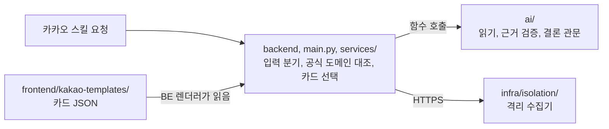

# 코딩 컨벤션

저장소에 포매터나 린터 설정은 두지 않았습니다. 대신 구조, 판정 코드, 계약, 로그, 테스트에 대한 규칙을 문서(`CLAUDE.md`, `docs/`, 각 폴더의 README)로 정하고 리뷰에서 지켰습니다.
이 페이지는 그 규칙과, 기준 커밋 `45871b8` 의 코드에서 실제로 지켜지고 있는 습관을 함께 정리한 것입니다. 숫자는 그 시점의 코드를 센 값입니다.

## 1. 구조와 의존 방향



- **의존 방향은 `backend` → `ai` 한 방향입니다.** `ai/` 안에서 `server` 를 import하지 않습니다.
- **`ai/` 는 카카오를 모릅니다.** 카카오 payload, 카드 형식, 격리 서버, 화이트리스트 파일을 `ai/` 에 들이지 않습니다(ADR 0001, ADR 0002).
- **카드 문구와 버튼은 FE가 JSON으로 소유하고**, 값을 채우고 카드를 고르는 렌더러는 BE(`services/`)가 맡습니다.
- **의심 URL에는 격리 서버만 접속합니다.** 메인 서버 코드에서 의심 URL로 요청을 보내지 않습니다(HEAD 요청 포함).

## 2. 판정 코드

- **판정은 결정적 코드가 합니다.** LLM에게 "위험한가"를 묻지 않습니다. 결론은 순수 함수가 정합니다(`select_result_card`, `decide_message`, `decide_call`).
- **LLM 출력은 후보입니다.** 근거가 실제 입력에 있는지 코드가 확인한 것만 결론의 입력으로 씁니다.
- **실패를 결과로 돌려줍니다.** AI 함수는 취소(`CancelledError`) 말고는 예외를 올리지 않고, 실패 이유를 `FailureCode` 로 결과에 담습니다. 실패를 정상이나 악성의 근거로 쓰지 않습니다.
- **LLM이 실패해도 응답은 나갑니다.** 사용자 문장은 코드 템플릿이 만들고, LLM 설명은 부가 기능으로 둡니다.

## 3. Python

| 항목 | 규칙 | 코드에서 |
| --- | --- | --- |
| 버전 | Python 3.11 이상 | `ai/pyproject.toml` |
| 타입 힌트 | 함수 인자와 반환에 타입을 적습니다 | 서버, AI 소스 71개 중 62개 |
| 열거형 | 값이 정해진 문자열은 `class X(str, Enum)` 으로 둡니다 | 34개 |
| 계약 모델 | 파트 사이에 오가는 데이터는 pydantic 모델로 둡니다 | `ai/src/ai/types.py`, `ai/src/ai/case/types.py` |
| 내보내는 모델 | 모르는 칸이 있으면 거부합니다(`StrictModel`, `extra="forbid"`) | `ai/src/ai/types.py` |
| 받는 모델 | 백엔드가 칸을 더해도 깨지지 않게 모르는 칸은 무시합니다(`InboundModel`, `extra="ignore"`) | `ai/src/ai/types.py` |
| 내부 값 | 파트 밖으로 나가지 않는 값은 `@dataclass` 를 씁니다 | 15개 파일 |
| 이름 | 함수, 변수는 `snake_case`, 클래스는 `PascalCase`, 모듈 상수는 `UPPER_SNAKE` 입니다. 모듈 안에서만 쓰는 것은 `_` 로 시작합니다 | |

## 4. 주석과 문서 문자열

- **모듈 맨 위에 문서 문자열로 이 파일이 무엇을 하고 무엇을 하지 않는지 적습니다.** 71개 중 64개가 그렇게 시작합니다.
- **주석은 한국어로, "무엇"보다 "왜"를 적습니다.** 근거가 되는 이슈, PR, ADR 번호를 함께 적습니다. 주석 714줄 중 593줄이 한국어입니다.

```python
"""검증된 근거와 쌓인 답으로 링크 없는 문자 결론을 정하는 순수 함수 (v3 §7·§8 중 문자 줄).

LLM·네트워크·시계를 쓰지 않는다. 처음 분석할 때와 답을 받을 때 같은 함수를 다시 돈다.
"""
```

## 5. 로그

- **`[대문자 태그] key=value` 꼴로 남깁니다.** 예: `[SKILL AUTH REJECTED] reason=secret_mismatch`, `[OFFICIAL_CHECK] demotion_reasons=…`. `main.py` 에만 태그가 37종 있습니다.
- **개인정보를 남기지 않습니다.** 문자 원문, URL, 사용자 ID, 콜백 토큰, 녹음 주소 대신 길이, 개수, 소요 시간, 상태만 남깁니다.

## 6. 시간 상한

- **모든 외부 호출에 상한을 둡니다.** LLM은 재시도하지 않습니다.
- **상한의 기준은 `docs/latency-budget.md` 입니다.** 상한을 바꿀 때는 이 문서를 먼저 고칩니다.
- **LLM 호출 예산은 호출하는 단계가 정해서 넘깁니다**(ADR 0004). 클라이언트 안에 상수로 박지 않습니다.

## 7. 계약 바꾸기

- **타입의 원본은 호출당하는 쪽(`ai/`)이 소유합니다.** `contracts/schemas/` 는 BE가 참고하도록 내보낸 사본입니다.
- **모델을 바꾸면 JSON 스키마를 다시 만들어 같은 PR에 올립니다.** 어긋나면 계약 테스트(`ai/tests/test_message_schema_contract.py`, `test_voice_schema_contract.py`)가 실패합니다. 절차는 `docs/contracts.md` 입니다.

## 8. 카드 JSON

- **파일 이름은 `화면코드-이름.json` 입니다**(예: `r1-lookalike.json`). 화면 코드는 `docs/designs/chatbot-copy.md` 와 같습니다.
- **바뀌는 값은 `{{ image_url }}` 처럼 중괄호 두 개로 표시합니다.** 내용은 카카오 스킬 응답 전체(`{"version": "2.0", "template": {…}}`)로 둡니다.
- **문구 원문은 `docs/designs/chatbot-copy.md` 입니다.** 문구를 바꾸면 카드 JSON과 원문을 함께 고칩니다.
- 규칙 전체는 `frontend/kakao-templates/README.md` 에 있습니다.

## 9. 테스트

| 항목 | 규칙 |
| --- | --- |
| 도구 | pytest, pytest-asyncio(`asyncio_mode = auto`) |
| 위치 | 유닛은 `ai/tests/`, 서버 통합은 `tests/` |
| 이름 | 무엇이 어떻게 되어야 하는지 영어 문장으로 씁니다. 예: `test_wrong_secret_is_rejected`, `test_l3_acquaintance_plus_money_is_suspected` |
| 외부 호출 | 실제 LLM API를 부르지 않습니다. 가짜 클라이언트와 고정 fixture를 씁니다 |
| 데이터 | 실제 스미싱 문자나 URL로 테스트하지 않습니다 |
| 버그 수정 | 가능하면 버그를 재현하는 테스트를 먼저 커밋하고 고칩니다. 예: 격리 서버 배포 스크립트 수정(#156)은 `test(isolation): …재현한다` 커밋 뒤에 `fix(isolation): …` 커밋이 이어집니다 |

기준 커밋에서 테스트 함수는 1,442개입니다.

## 10. 비밀값

- 비밀값은 `.env` 에만 두고 커밋하지 않습니다. 필요한 키는 `.env.example` 에 이름만 적습니다.
- 팀원끼리 비밀값을 주고받는 방법은 `docs/runbook/secrets.md` 를 따릅니다.
