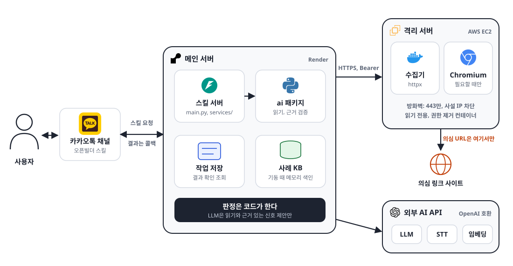

# 1. 아키텍처 설계

<figure class="figure"></figure>

| 구성 요소 | 하는 일 | 위치 |
| --- | --- | --- |
| 카카오톡 채널 | 모든 입력을 스킬 서버로 보내고, 결과를 콜백으로 받습니다 | 카카오 관리자센터 |
| 스킬 서버 | 입력 분기, 공식 도메인 대조, 카드 선택, 콜백 | `main.py`, `services/` |
| ai 패키지 | 문자 읽기, 근거 검증, 결론 관문, 사례 검색. 스킬 서버와 같은 프로세스에서 함수로 부릅니다 | `ai/` |
| 작업 저장, 사례 검색(RAG) | 분석 결과를 저장해 「결과 확인」에 다시 보냅니다. 사례 검색은 피해 사례 629건(문자 502건, 통화 127건)에서 비슷한 사례를 찾아 보여 주는 RAG 검색이고, 서버가 뜰 때 메모리에 색인합니다 | `main.py`, `ai/src/ai/kb/` |
| 격리 서버 | 의심 링크에 접속해 이동 경로와 페이지를 모읍니다. 판정하지 않습니다. 443 포트만 나가고 사설 IP는 막힌, 읽기 전용 컨테이너에서 돕니다 | `infra/isolation/` |
| 외부 AI API | LLM(Claude), 받아쓰기(STT), 임베딩. 실패해도 다시 부르지 않고, 단계마다 시간 상한을 둡니다 | 엘리스 ML API(OpenAI 호환) |
| 카드 템플릿 | 문구, 버튼, 이미지 41개. 스킬 서버가 빈칸을 채웁니다 | `frontend/kakao-templates/` |

## 문자 분석 흐름

  
<i class="code">코드</i><b>대기 응답</b>"확인하고 있어요"를 먼저 보내고 뒤에서 분석<em>5초 안</em>

  
<i class="llm">LLM</i><b>문자 읽기</b>업체, 요구 행동, 링크를 뽑고 원문과 대조<em>최대 15초</em>

  
<i class="ext">격리</i><b>링크 수집</b>격리 서버가 링크를 열어 이동 경로와 페이지 수집. 그동안 문자 속 위험 신호를 함께 찾음<em>최대 17초</em>

  
<i class="code">코드</i><b>공식 도메인 대조</b>화이트리스트와 비교, 경유지가 수상하면 보류<em>즉시</em>

  
<i class="llm">LLM</i><b>페이지 검사</b>로그인, 앱 설치 요소를 찾고 근거 있는 신호만 채택<em>최대 6초</em>

  
<i class="code">코드</i><b>카드 선택, 콜백</b>규칙으로 결과 카드를 골라 카카오로 전송<em>남은 시간</em>

문자 읽기 15초+링크 수집 17초+페이지 검사 6초=<b>최대 38초</b><small>나머지는 카드를 만들고 저장하는 여유로 두어, 전체 분석이 45초 안에 끝납니다. 실제 문자 읽기는 보통 2초 안팎입니다.</small>

## 링크 없는 문자와 통화 녹음 흐름

LLM이 신분 주장과 요구를 인용과 함께 읽고, 코드가 인용을 원문과 대조한 뒤 결론 관문이 결론을 냅니다.

| 흐름 | 단계 | 시간 |
| --- | --- | --- |
| 링크 없는 사칭 문자 | 문자 읽기 → 개인정보 가리기 → 주장 읽기(사례 검색과 함께) → 인용 확인, 공식 대표번호 대조 → 결론 | 15초 + 12초 = 최대 약 28초 |
| 통화 녹음 | 녹음 받기 → 받아쓰기 → 주장 읽기(사례 검색과 함께) → 받는 사람 쪽 말 거르기, 인용 확인 → 결론 | 15초 + 30초 + 남은 시간. 전체 45초 안 |

받아쓰기는 실측 2~11초라 대부분 주장 읽기까지 시간이 충분합니다. 남은 시간이 5초보다 적으면 LLM 대신 어휘표로 읽습니다.

## 결론 규칙

**링크가 있는 문자**는 위에서부터 먼저 맞는 카드가 나갑니다. 실패나 미확인은 결론을 올리지도 내리지도 않고 "판단하기 어려워요"로 보냅니다.

| 조건 | 결과 카드 |
| --- | --- |
| 문자나 페이지에 검증된 위험 신호가 있다 | ⚠️ 스미싱이 의심돼요 |
| 공식 주소이고, 문자와 페이지 모두 위험 신호가 없다 | 🔗 ○○ 공식 주소와 같아요 |
| 알려진 업체를 내세웠는데 그 업체의 공식 주소가 아니다 | 🔎 공식 주소가 아니에요 |
| 그 밖 (업체 모름, 수집 실패, 비공식 경유) | 🤔 판단하기 어려워요 |

공식 주소인지는 이렇게 봅니다.

1. 단축 주소(9개 서비스)는 건너뛰고 첫 실제 주소를 대조합니다.
2. 문자가 내세운 업체가 화이트리스트에 있고, 주소가 그 업체의 공식 도메인이나 그 하위 도메인이면 공식 주소입니다.
3. 공식 주소여도 수집이 실패했거나, 이동 경로나 브라우저 이동 기록에 비공식 주소가 끼어 있으면 판단을 보류합니다(ADR 0009).

**링크가 없는 문자와 통화**는 신분 주장과 요구가 함께 있는지로 가릅니다.

| 결론 | 링크 없는 사칭 문자 | 통화 녹음 |
| --- | --- | --- |
| 의심 | 가족, 지인을 내세워 돈, 상품권, 인증번호를 요구하고, 원래 번호로 확인해 보니 본인이 아니라고 답했다 | 기관을 내세워 송금, 앱 설치, 원격 제어, 개인정보, 인증번호, 현금 전달을 요구하거나, 지인을 내세워 송금을 요구한다 |
| 주의 | 위험한 요구나 신분 주장이 있지만 의심 조건을 다 채우지 않았다 | 같습니다. 자주 사칭되는 공공기관 8곳은 주의까지만 씁니다(ADR 0010) |
| 찾지 못함 | 신분 주장도 요구도 없다 | 같습니다 |

통화에서 받는 사람이 한 말(되묻기, 옮긴 말, 약속)은 근거에서 뺍니다(ADR 0008).

## 기술 스택

| 영역 | 기술 | 쓰는 곳 |
| --- | --- | --- |
| 챗봇 채널 | 카카오 i 오픈빌더 스킬, AI 챗봇 콜백 | 입력을 받고 결과 카드를 보냅니다 |
| 메인 서버 | Python 3.11, FastAPI, uvicorn, httpx | 입력 분기, 공식 도메인 대조, 카드 선택, 콜백 |
| 데이터 형식 | pydantic 2, JSON 스키마 | 파트 사이에 주고받는 결과 형식 |
| LLM | Claude Haiku 5.5. 엘리스 ML API의 OpenAI 호환 주소로 부릅니다(openai SDK, 구조화 출력) | 문자 읽기, 위험 신호 제안, 페이지 검사, 주장 읽기 |
| 받아쓰기 | whisper-large-v3 | 통화 녹음을 글로 바꿉니다 |
| 임베딩, 사례 검색 | text-embedding-3-large, TF-IDF와 임베딩을 섞은 점수 | 비슷한 사례를 찾습니다. 판정에는 쓰지 않습니다 |
| 격리 서버 | Docker, Playwright Chromium, iptables 방화벽, systemd | 의심 링크 접속과 수집 |
| 카드 | 카카오 스킬 응답 JSON 템플릿 41개 | 결과 카드, 자세히 보기 캐러셀, 질문 카드 |
| 배포 | Render(메인 서버), AWS EC2(격리 서버) | |
| 테스트 | pytest, pytest-asyncio | 유닛, 통합, 계약 테스트 |
