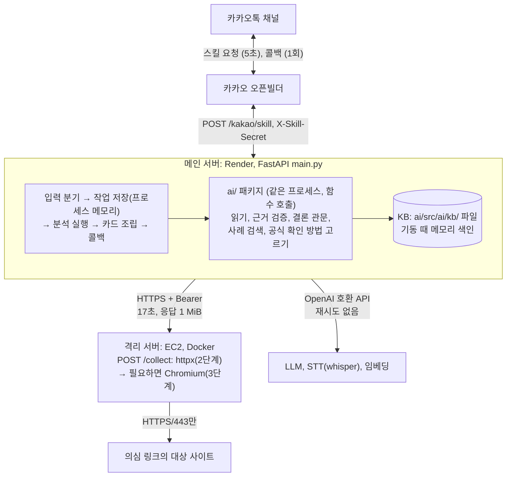
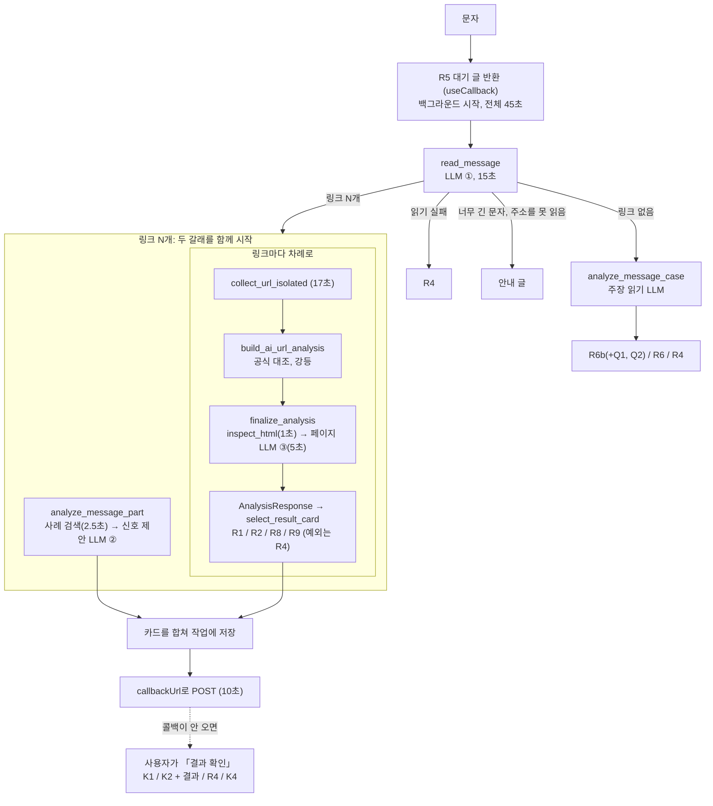
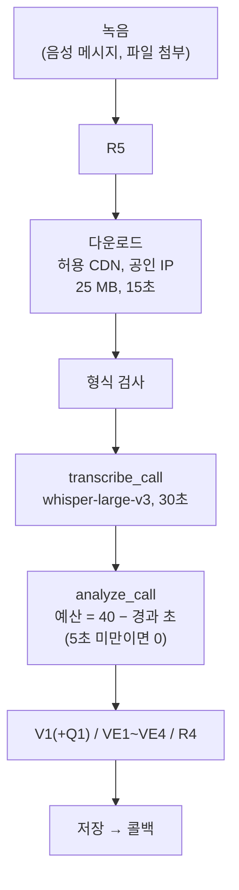
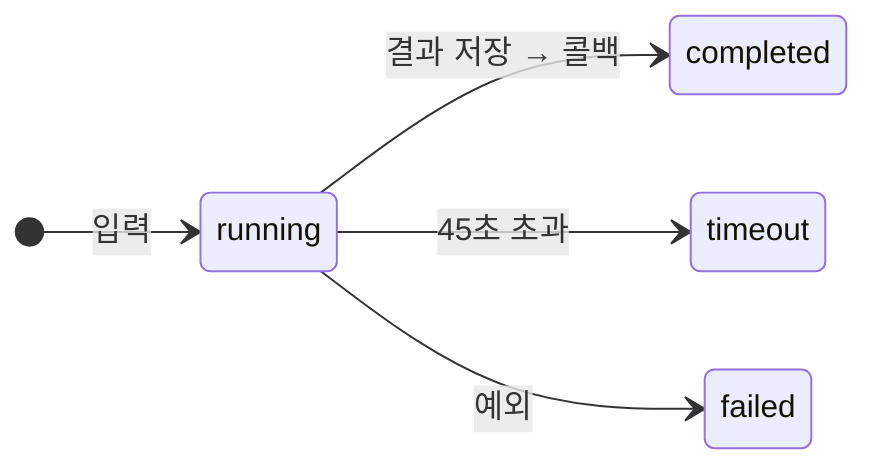
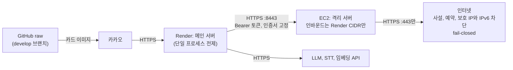

# 1. 아키텍처 설계

> 💡 전체 구조·흐름, 에이전트 설계(단계·도구·상태·예외), 기술 스택·배포 구성

## 1.1 전체 구조

| 구성 요소 | 하는 일 | 위치 | 담당 |
| --- | --- | --- | --- |
| 카카오 오픈빌더 | 블록·버튼·콜백. 폴백 블록이 모든 입력을 스킬로 보낸다 | 관리자센터 | FE·BE |
| 메인 서버 | 입력 분기, 작업 저장, 격리 수집 호출, 공식 도메인 대조, 카드 선택·조립, 콜백 | `main.py`, `services/`, `backend/`, `scanner/` | BE |
| 카드 템플릿 | 문구·버튼·이미지(41개). 렌더러가 빈칸을 채운다 | `frontend/kakao-templates/` | FE |
| AI 패키지 | 읽기, 근거 검증, 결론 관문, 사례 검색, 공식 확인 방법 고르기 | `ai/` | AI |
| 결과 스키마 | BE↔AI 계약(pydantic 원본 + JSON 스키마 사본) | `contracts/schemas/`, `docs/scheme.md` | AI |
| 격리 서버 | 의심 링크 접속과 수집만 한다. 판정하지 않는다 | `infra/isolation/` | BE |
| 외부 AI API | LLM, STT, 임베딩 | 환경변수로 지정 | AI |

의존 방향은 `backend` → `ai` 한 방향이다. `ai/`는 카카오 형식, 격리 서버, 화이트리스트 파일을 모른다(ADR 0001·0002).

## 1.2 흐름

**입력 분기** (`main.py` `kakao_skill`, 위에서부터 먼저 맞는 것)

1. `callbackUrl`이 허용 호스트가 아니다 → R4
2. `action.clientExtra.job_id`가 있다(`자세히 보기`) → 저장한 결과로 캐러셀
3. `clientExtra`에 `case_id`·`question_id`·`option_id`가 있다(Q1·Q2 항목) → 답 처리
4. `intent.name == "결과 확인"` → 사용자의 최근 작업 결과
5. 녹음이다(`params.media.type == "audio"` 또는 허용 CDN의 오디오 주소) → 녹음 흐름
6. 빈 입력 → R6
7. 같은 사용자의 분석이 진행 중이다 → K5
8. 그 밖 → 문자 흐름. `callbackUrl`이 없으면(개발·테스트) 그 자리에서 동기로 처리한다

**문자 흐름**

**녹음 흐름**

**버튼·답 흐름:** `자세히 보기`와 Q1·Q2 답은 저장한 결과만으로 바로 답한다. 다시 분석하지 않고 LLM과 네트워크를 쓰지 않으며 콜백도 쓰지 않는다.

## 1.3 에이전트 설계

### 설계 원칙

- **고정 단계 파이프라인이다.** 조사 순서, 결론, 붙일 질문은 코드가 정한다. LLM은 정해진 단계에서 읽기만 하고 도구를 부르지 않는다. 2026-10-27 설계 v3에서 v1.0의 자율 보강 루프(⑤)와 조회 한도를 없앴다(PR #86 멘토 리뷰 "LLM과 코드의 역할", 커밋 `fa4d414`).
- **LLM 출력은 후보다.** 근거가 실제 입력에 있는 것만 결론의 입력이 된다.
- **어느 단계가 실패해도 결과는 나간다.** 실패 사유는 `failures`에 남기고 확인하지 못한 범위로 보여 준다. 실패를 정상이나 악성의 근거로 쓰지 않는다.

### 단계

**링크가 있는 문자**

| # | 단계 | 주체 | 입력 → 출력 | 상한 | 실패하면 |
| --- | --- | --- | --- | --- | --- |
| 1 | 문자 읽기 `read_message` | LLM ① + 코드 검증 | 원문 → 브랜드·주제·요구 행동·링크, `unverified_links` | 15초 | R4. 너무 긴 문자·못 읽은 주소는 안내 글 |
| 2 | 사례 검색 `search_cases` | 코드 + 임베딩 | 링크를 뗀 본문 → 유사 사례 | 2.5초 | 미확인. 임베딩만 실패하면 TF-IDF로 검색 |
| 3 | 문자 신호 제안 `analyze_signals` | LLM ② + 코드 검증 | 본문·추출 결과·사례 → 검증된 신호 | 30초 (전체 45초 안) | 확보한 문자 근거를 유지하고 사유를 남긴다 |
| 4 | 격리 수집 `collect_url_isolated` | 격리 서버 | URL → `CollectResult` | 17초 | `collection_failed`로 채우고 계속한다 |
| 5 | 공식 대조·강등 `build_ai_url_analysis` | 코드(BE) | 브랜드·수집 결과 → `url.official` | | 확인하지 못하면 `unresolved` |
| 6 | 페이지 검사 `inspect_html` | 코드(별도 스레드) | HTML → 텍스트·요소(ID) | 1초 | 읽은 데까지 유지하고 LLM을 부르지 않는다 |
| 7 | 페이지 신호 제안 `analyze_page` | LLM ③ + 코드 검증 | 텍스트·요소 → 브랜드·주제·검증된 신호 | 5초 | `env`를 `partial`이나 `failed`로 둔다 |
| 8 | 결과 조립 `assemble_analysis` | 코드 | 1~7의 결과 → `AnalysisResponse` | | |
| 9 | 카드 선택 `select_result_card` | 코드(BE) | `AnalysisResponse` → R1·R2·R8·R9 | | 그 링크의 분석이 예외로 끝나면 R4 |

2·3은 첫 링크의 수집(4)과 함께 시작한다. 4~9는 링크마다 차례로 돈다.

**링크가 없는 문자** (1단계 `read_message`가 링크가 없다고 확인한 뒤. 전체 예산 `40 − 경과 초`)

| # | 단계 | 주체 | 상한 | 실패하면 |
| --- | --- | --- | --- | --- |
| 1 | 개인정보 가리기 `mask_pii` | 코드 | | |
| 2 | 주장 읽기 `read_claims` | LLM | 12초 | 어휘표로 읽는다(`reading_status=fallback`) |
| 3 | 사례 검색 | 코드 + 임베딩 | 2.5초 (2와 함께) | 미확인 |
| 4 | 인용 검증 `verify` | 코드 | | 버린 주장은 사유와 함께 `rejected`에 남긴다 |
| 5 | 공식 대표번호 대조 | 코드(KB) | | |
| 6 | 결론 관문 `decide_message` | 코드 | | 읽지 못했으면 `not_analyzable` |
| 7 | 카드 R6b·R6·R4와 Q1·Q2 | 코드(BE) | | |

**통화 녹음** (`analyze_call` 예산 `40 − 경과 초`. 5초 미만이면 0을 넘겨 LLM 단계를 건너뛴다)

| # | 단계 | 주체 | 상한 | 실패하면 |
| --- | --- | --- | --- | --- |
| 1 | 녹음 받기 `download_voice_media` | BE | 15초, 25 MB | 허용되지 않은 주소·내려받기 실패는 R4, 25 MB 초과·빈 파일은 VE2 |
| 2 | 형식 검사 `inspect_voice_audio` | BE | | 오디오가 아니면 VE1, 읽을 수 없으면 VE2 |
| 3 | 받아쓰기 `transcribe_call` | STT + 코드(문장 분할·개인정보 가림) | 30초 | 대본이 없으면 VE3, 호출 예외는 R4 |
| 4 | 주장 읽기 `read_claims` | LLM | 12초 | 어휘표로 읽는다 |
| 5 | 받는 사람 쪽 말 거르기·인용 검증 | 코드(`forms`, `verify`) | | 버린 주장은 `rejected` |
| 6 | 번호 대조 | 코드(KB) | | |
| 7 | 사례 검색 + 사례 첨부 관문 | 코드 + 임베딩 | 2.5초 (4와 함께) | 미확인 |
| 8 | 결론 관문 `gate` | 코드 | | |
| 9 | 카드 V1·VE4와 Q1 | 코드(BE) | | |

### 도구

| 도구 | 부르는 쪽 | 입력 → 출력 | 하지 않는 일 |
| --- | --- | --- | --- |
| 격리 수집 API `POST /collect` | BE | URL → 이동 경로, 상태 코드, HTML, 브라우저 기록 | 판정. 파일 저장·실행. 폼 입력·클릭·제출 |
| 공식 도메인 화이트리스트 | BE | 브랜드·호스트 → `official` / `brand_mismatch` / `not_registered` | 목록에 없는 브랜드를 추측하기 |
| 단축 주소 해석 | BE | 입력 주소와 리다이렉트 경로 → 첫 실제 호스트 | 직접 접속. 수집 결과만 읽는다 |
| 페이지 검사 `inspect_html` | AI | HTML → 텍스트·요소(ID) | 스크립트 실행, 외부 요청 |
| 사례 KB 검색 | AI | 본문·대본 → 유사 사례와 점수 | 판정에 쓰이기 |
| 규범 KB `find_guidance` | BE 카드 렌더러 | 결과의 brand·category·doubts·official → 공식 확인 방법 최대 3개 | LLM·자유 텍스트 사용 |
| 공식 대표번호 KB | AI | 기관 → 대표번호 | |
| LLM | AI | 시스템 프롬프트 + 데이터 구획 → 구조화 출력 | 도구 호출, 판정, 자유 텍스트 응답 |
| STT | AI | 녹음 → 대본 | 화자 분리 |
| 임베딩 | AI | 문장 → 벡터 | |

LLM에는 도구 호출 권한이 없다. 어떤 도구를 어떤 순서로 몇 번 부를지는 코드에 고정돼 있고, 페이지나 문자 내용으로 바꿀 수 없다.

### 상태

**작업 상태**

- `callback_status`: `pending` → `success` 또는 `failed`
- `RUNNING_USERS`: 시작할 때 `user_id` 추가, 끝나면 제거 (그동안 새 입력은 K5)

작업은 프로세스 메모리 `ANALYSIS_JOBS[job_id]`에 있다(`main.py`).

| 필드 | 값 | 쓰임 |
| --- | --- | --- |
| `job_id` | UUID4 | 결과 카드 `자세히 보기` 버튼의 `extra.job_id` |
| `user_id` | 카카오 `userRequest.user.id` 원문 | 「결과 확인」에서 사용자의 가장 최근 작업을 찾는다 |
| `status` | `running` / `completed` / `failed` / `timeout` | K1·K2·R4 분기 |
| `created_at`, `completed_at` | ISO 8601 (UTC) | 최근 작업 선택, K2 확인 시각(KST HH:MM) |
| `result` | 렌더링한 카카오 응답 | 콜백 본문, 「결과 확인」 응답 |
| `final_payload` | `AnalysisResponse` / `MessageCaseResult` / `VoiceCaseResult`의 JSON | 캐러셀 재생성, Q1·Q2 답 처리. 링크가 여럿이면 마지막 링크 결과만 남는다 |
| `analysis_kind` | 없음(링크 문자) / `message_case` / `voice` | 렌더러·답 처리 선택 |
| `link_count` | 정수 | 2 이상이면 상세를 주지 않는다 |
| `qa_answers` | 통화 Q1 답 목록 | 통화 답 누적. 문자 답은 `final_payload.answers`에 쌓인다 |
| `error` | `analysis_timeout` 또는 예외 이름 | 진단 |
| `callback_status`, `callback_error` | `pending` → `success` / `failed`, 토큰을 뺀 요약 | 진단 |

**분석 값**

| 값 | 쓰는 곳 | 값의 종류 |
| --- | --- | --- |
| `url.official` | 링크 | `official`, `brand_mismatch`, `not_registered`, `unresolved` |
| `message.answer`, `env.answer` | 링크 | `no_risk_found`, `risk_found`, `partial`, `failed`, `not_run` |
| `conclusion` + `caution` | 링크 없는 문자·통화 | `suspected`, `official_domain`, `inconclusive`, `not_analyzable`, `input_required` + 주의 여부 |

**대화 상태:** 세션이 없다. 「결과 확인」은 그 사용자의 가장 최근 작업을 본다. Q1·Q2 답은 작업에 쌓이고, 답할 때마다 결론과 대응을 다시 정한다.

### 결론 규칙

**링크: 공식 도메인 대조** (`build_ai_url_analysis`, `services/official_domain_service.py`)

1. 단축 주소(9개 서비스)를 건너뛴 첫 실제 호스트를 대조 대상으로 삼는다.
2. 문자의 브랜드가 화이트리스트에 있고 도메인이 그 브랜드의 공식 도메인(또는 그 하위 도메인)이면 `official`, 아니면 `brand_mismatch`다. 브랜드가 목록에 없으면 `not_registered`, 호스트를 확인하지 못하면 `unresolved`다.
3. `official`이어도 아래 중 하나에 해당하면 `unresolved`로 내린다.
    - 최종 주소나 HTML이 없거나, 수집이 실패했다.
    - 리다이렉트 경로에 비공식 호스트가 있다.
    - 브라우저 수집이 실패했거나 내려받기가 일어났거나 이동 기록이 없다.
    - 브라우저의 이동 기록·이동 요청·최종 주소에 비공식 호스트가 있다(ADR 0009).

**링크: 카드 선택** (`select_result_card`, 위에서부터 먼저 맞는 것)

| 조건 | 카드 |
| --- | --- |
| 문자나 페이지에 검증된 신호가 하나라도 있다 | R1 `스미싱이 의심돼요` |
| `official`이고 문자·페이지가 모두 `no_risk_found` | R2 `○○ 공식 주소와 같아요` |
| `official`인데 위 조건을 못 채운다 | R9 `판단하기 어려워요` |
| `brand_mismatch`이고 브랜드를 안다 | R8 `공식 주소가 아니에요` |
| 그 밖(`not_registered`, `unresolved`, 브랜드 모름) | R9 |
| 그 링크의 분석이 예외로 끝났다 | R4 |

**링크 없는 문자·통화**

| 결론 | 링크 없는 문자 (`message_gate.py`) | 통화 (`gate.py`) |
| --- | --- | --- |
| `suspected` | 가족·지인 주장 + 돈·상품권·인증번호 요구 + Q2 답 "본인이 아니래요"(L-4) | 꼴이 맞은 기관 주장 + 꼴이 맞은 요구(송금·앱 설치·원격 제어·정보·인증번호·현금 전달), 또는 꼴이 맞은 지인 주장 + 꼴이 맞은 송금 요구(L-3) |
| `inconclusive` + 주의 | 위험 요구나 기관·지인 주장이 있지만 `suspected` 조건을 못 채웠다. 기관 사칭 문자는 주의까지만 쓴다 | 같다. 자주 사칭되는 공공기관 8곳은 주의까지만 쓴다(ADR 0010) |
| `input_required` | 신분 주장도 요구도 없다 → R6 | 사칭·요구가 없다 → VE4 |
| `not_analyzable` | 읽지 못했다 → R4 | 받아쓰지 못했다 → VE3 |

- Q2 답 "본인이 맞대요"는 주의만 끈다. 결론을 안전 쪽으로 옮기지 않는다.
- 통화에서 받는 사람 쪽 말(옮긴 말, 되묻기, 부탁 없는 물음, 1인칭 약속)은 근거에서 뺀다(ADR 0008).

### 예외

1. AI 함수는 취소(`CancelledError`) 말고는 예외를 올리지 않는다. 실패는 `failures`(FailureCode)와 `unchecked`에 남긴 결과로 돌려준다.
2. 메인 서버는 링크 하나의 분석 실패를 그 링크의 R4로 가둔다. 다른 링크의 결과는 그대로 보낸다.
3. 실패는 결론을 올리지도 내리지도 않는다. 수집 실패는 `unresolved`(판단 보류)가 되고, 읽기 실패는 분석 불가가 된다.
4. LLM 호출은 재시도하지 않는다. 격리 HTTP 수집만 시간 초과일 때 5초 상한으로 한 번 더 받는다.
5. 전체가 45초를 넘으면 작업을 취소하고 `timeout`으로 저장한다.

사용자에게 보이는 예외 응답은 3.3, 외부 의존 장애 대응은 3.4에 있다.

## 1.4 기술 스택

| 영역 | 기술 | 비고 |
| --- | --- | --- |
| 챗봇 채널 | 카카오 i 오픈빌더 스킬 + AI 챗봇 콜백 | 스킬 응답 5초, 콜백 1회 |
| 메인 서버 | Python 3.11 이상, FastAPI, uvicorn, httpx, idna | `requirements.txt` |
| AI 패키지 | pydantic 2, openai SDK 2, PyYAML, httpx | `ai/pyproject.toml`. 메인 서버에 editable로 설치한다 |
| LLM | OpenAI 호환 API(`LLM_MODEL`, 주장 읽기는 `CLAIMS_MODEL`) | 구조화 출력 `chat.completions.parse`, `temperature=0`, 재시도 0. 2026-10-31 실측 모델 `claude-haiku-5-5` |
| STT | whisper-large-v3, OpenAI 호환 `/v1/audio/transcriptions` | `language=korean` |
| 임베딩 | text-embedding-3-large, 엘리스 ML API의 OpenAI 호환 `/v1/embeddings` | |
| 사례 검색 | 문자 n-gram TF-IDF와 임베딩 코사인을 섞은 점수, 프로세스 메모리 색인 | 판정에 쓰지 않는다 |
| 사례 첨부 관문 | 순수 Python 선형 모델(`voice_gate.json`) | 학습은 오프라인 sklearn |
| 격리 서버 | Docker(읽기 전용 FS, `cap_drop: ALL`, seccomp, 메모리 1.5 GiB, CPU 1.5, PID 256, 비루트 사용자), Starlette + uvicorn(TLS 8443), httpx 0.28.1, Playwright 1.63.0 + Chromium, iptables 호스트 방화벽, systemd | `infra/isolation/` |
| 카드 | 카카오 스킬 응답 JSON 템플릿 41개, 이미지는 GitHub `develop` 브랜치 raw 주소 | `frontend/kakao-templates/` |
| 저장소 | 없음. 작업은 프로세스 메모리, KB는 Markdown·YAML·JSON 파일 | |
| 테스트 | pytest, pytest-asyncio | |

**기술 선택 이유**

| 선택 | 이유 | 대가 | 근거 |
| --- | --- | --- | --- |
| AI를 같은 프로세스의 패키지로 | 5초 예산에서 네트워크 왕복과 콜드 스타트를 없앤다 | AI만 따로 늘리지 못한다 | ADR 0001 |
| 자체 격리 수집기 | urlscan은 약 30초가 걸리고 통제할 수 없었다. 링크를 외부 스캐너에 제출하지 않는다 | EC2·방화벽·재배포를 직접 운영한다 | ADR 0002·0003 |
| 콜백 + 「결과 확인」 | 느린 경로에서도 결과가 나간다 | 콜백이 실패하면 사용자가 「결과 확인」을 보내야 한다 | ADR 0003 |
| 카드와 캐러셀만 | 챗봇 밖으로 나가지 않고, 토큰·조회 API·배포 대상이 늘지 않는다 | 글자 수 제약, 관측 원자료·시각을 못 보여 준다 | ADR 0005·0006 |
| 링크 추출을 LLM으로 | 정규식은 바꿔 적은 주소, 조사 붙은 주소, `@` 위장 주소를 놓친다 | LLM이 실패하면 링크를 모른다 | ADR 0007 |
| 결론을 코드 규칙으로 | 재현성과 설명 가능성 | 링크마다 다른 조사 경로를 고르지 못한다 | `fa4d414` |
| 통화 화자 분리 대신 문장 꼴 | 녹음 1건당 평균 4.9초를 줄이고 정상 통화 오탐을 줄였다 | 납치 유형 등 일부를 놓친다 | ADR 0008 |
| 브라우저 이동 요청까지 대조 | 스크립트로 이동하는 공식 사이트에도 결론을 준다 | 스냅샷 뒤의 이동은 보지 못한다 | ADR 0009 |
| 공공기관은 주의까지만 | 근거가 없어 "확인할 주소가 없어요"로 끝나던 문자를 막는다 | 정상 안내에도 주의가 나간다 | ADR 0010 |
| 프로세스 메모리 저장 | 프로토타입 검증 속도 | 재시작하면 사라지고 인스턴스를 늘릴 수 없다 | `main.py` TODO |

## 1.5 배포 구성

| 대상 | 배포 | 확인 |
| --- | --- | --- |
| 메인 서버 | Render. `uvicorn main:app`. 배포용 브랜치 `test/render`(브랜치 이름과 병합 이력 기준. Render 설정은 저장소에 없다) | 기동 로그 `[KB WARMUP]`·`[VOICE KB WARMUP]`. 적재가 끝난 뒤 요청을 받는다 |
| 격리 서버 | EC2. `infra/isolation/build.sh`로 이미지를 만들고 `install-units.sh`로 systemd 유닛을 깐다: 방화벽, 컨테이너(`Restart=always`), 하루 한 번 재생성, 5분마다 상태 확인 후 이상하면 재시작. 마지막 배포 2026-11-06 `d3fad6c` | `verify.py`. 순서와 되돌리기는 `docs/isolation-collector-api.md` |
| 카카오 챗봇 | 관리자센터: 폴백 블록 → 스킬 `/kakao/skill`, 헤더 `X-Skill-Secret`, 콜백 사용, `결과 확인` 블록, 봇 리스트 메뉴 3개. 블록 구성은 `docs/designs/chatbot-flow.md` 3절 | 개발 채널에서 카드 확인(`docs/designs/kakao-chatbot-build-guide.md`) |

**환경변수 (메인 서버)**

| 이름 | 쓰는 곳 | 비고 |
| --- | --- | --- |
| `APP_ENV` | 스킬 인증 | 기본 `production`. `local`·`test`만 비밀값 검사를 건너뛴다 (`.env.example`에 없음) |
| `KAKAO_SKILL_SECRET`, `KAKAO_SKILL_SECRET_PREVIOUS` | 스킬 인증 | 비면 모두 401. `_PREVIOUS`는 키 교체 기간에만 |
| `KAKAO_CALLBACK_HOSTS` | 콜백 허용 호스트 | 비면 `kakao.com`과 하위 도메인 |
| `KAKAO_MEDIA_HOSTS` | 녹음 다운로드 허용 호스트 | 비면 녹음 다운로드를 모두 거부한다 |
| `LLM_API_KEY`, `LLM_BASE_URL`, `LLM_MODEL` | 문자·페이지 LLM. 키는 STT·임베딩과 같이 쓴다 | 주소는 `/v1`까지 |
| `CLAIMS_MODEL` | 주장 읽기 | 비면 `LLM_MODEL` |
| `STT_BASE_URL`, `STT_MODEL` | 받아쓰기 | 주소에 `/v1`을 붙이지 않는다. 기본 `whisper-large-v3` |
| `EMBEDDING_BASE_URL`, `EMBEDDING_MODEL` | 사례 검색 임베딩 | 주소에 `/v1`을 붙이지 않는다. 기본 `text-embedding-3-large`. 비면 TF-IDF만 쓴다 (`.env.example`에 없음) |
| `ISOLATION_API_URL`, `ISOLATION_API_TOKEN`, `ISOLATION_API_CA_CERT` | 격리 수집 API | URL을 비우면 수집을 끈다(모든 링크가 수집 실패로 처리된다) |
| `LOG_LEVEL` | 로그 | |

격리 서버 설정(`collector.env`, `egress-hosts`, Render CIDR, 보호 호스트)은 `docs/isolation-collector-api.md` 6절에 있다. 비밀값은 팀 시크릿 저장소에서 받는다(`docs/runbook/secrets.md`).
